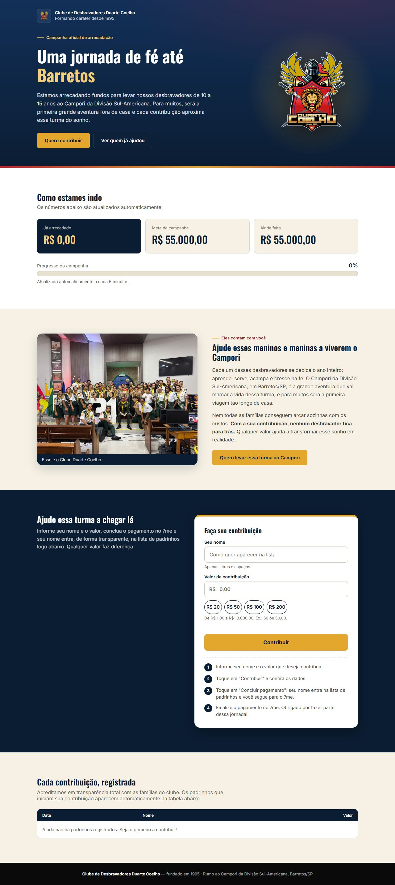
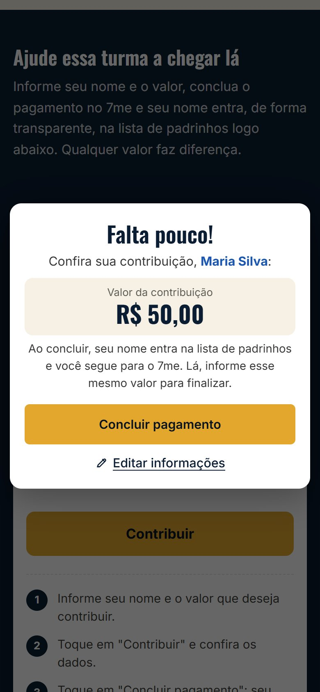
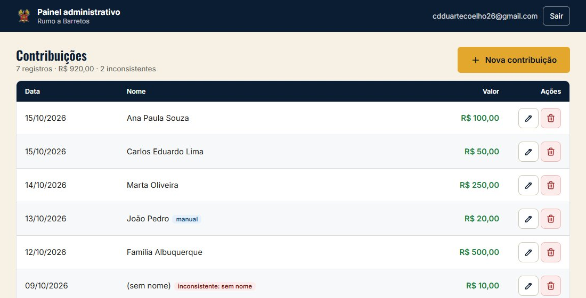
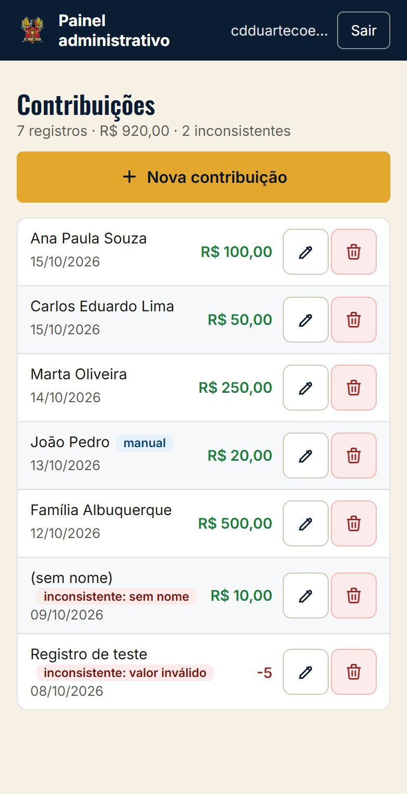
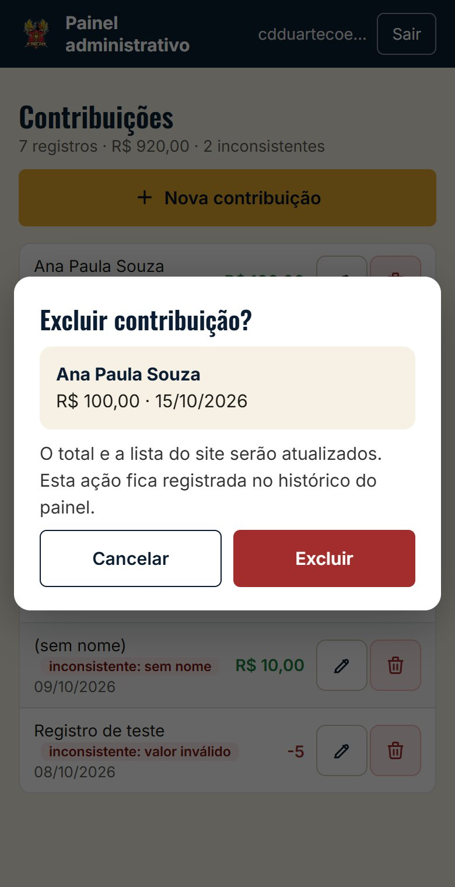

# Rumo a Barretos — Clube de Desbravadores Duarte Coelho

Site da campanha **"Rumo a Barretos"**, feito para o **Clube de Desbravadores Duarte Coelho**.

**Versão 2.1.1** · **Site no ar: https://campanha-clube-duarte-coelho.web.app**

## Sobre o projeto

Este é um **projeto voluntário**, desenvolvido sem fins lucrativos para apoiar o Clube de Desbravadores Duarte Coelho em sua jornada de fé e na arrecadação da campanha.

O objetivo é levar os desbravadores de 10 a 15 anos ao Campori da Divisão Sul-Americana, em Barretos/SP.

## Como o site é



### No celular

<p>
  
  
  
  
</p>

## Como funciona a contribuição

1. A pessoa informa **nome** e **valor** (ou escolhe um valor sugerido).
2. Ao tocar em **Contribuir**, abre um pop-up para **conferir os dados**. Nada é gravado ainda.
3. Se algo estiver errado, **Editar informações** volta ao formulário com os dados preenchidos.
4. Ao tocar em **Concluir pagamento**, o nome entra na **lista de padrinhos** e o **7me** (plataforma de doações da Igreja Adventista, desenvolvida pela IATec) abre em **outra aba** ou no aplicativo, para finalizar o pagamento.
5. A página atual já fecha o pop-up, mostra o aviso "Obrigado, [nome]!" e exibe o nome na lista. Se o navegador bloquear a nova aba, o 7me abre nesta mesma aba e, **ao voltar**, o pop-up fecha sozinho e a lista já está atualizada.

O pop-up é travado de propósito: Esc e clique fora não fecham. As únicas saídas são **Concluir pagamento** e **Editar informações**.

## Funcionalidades

- **Painel de progresso:** valor arrecadado, meta e quanto falta, com barra de progresso atualizada automaticamente.
- **Validação dos campos:** o nome aceita só letras, e o valor aceita só números no formato brasileiro (de R$ 1,00 a R$ 10.000,00), com mensagens claras.
- **Lista de padrinhos:** transparência com as famílias do clube, da contribuição mais recente para a mais antiga.
- **Resistente a falhas:** tempo limite e mensagem de erro se a internet ou o servidor falharem, e "Tentar de novo" no painel.
- **Responsivo e acessível:** pensado primeiro para o celular, com botão fixo "Quero contribuir", navegação por teclado, link para pular o conteúdo e contraste conforme WCAG AA.
- **Compartilhamento:** prévia com imagem e descrição ao compartilhar o link no WhatsApp e nas redes.
- **Seguro:** regras do banco que só permitem criar contribuições válidas (sem editar nem apagar) e cabeçalhos de segurança no Hosting.

## Painel administrativo

Página restrita para o clube corrigir a lista de padrinhos. Ela só abre pelo endereço com a **chave secreta** (`/admin/<chave>/`) e exige **login com uma conta Google autorizada**. A chave sozinha não é a proteção: quem decide quem pode editar ou apagar é o banco de dados (veja as regras em `database.rules.json`).

<p>
  
  
  
</p>

*Capturas com dados fictícios.*

- **Tabela igual à do site**, com um botão de **editar** e um de **excluir** em cada linha, e **Nova contribuição** para registros manuais (marcados com a etiqueta "manual" só no painel).
- **Exclusão uma por vez**, com confirmação mostrando o registro. Não existe seleção múltipla.
- **Registros inconsistentes** (sem nome, valor inválido) aparecem destacados e só podem ser salvos depois de corrigidos.
- **Mesmas validações do site** (`public/js/validation.js`), mais uma validação final do registro inteiro antes de gravar. As regras do banco repetem os limites como segunda barreira.
- **Histórico**: toda criação, edição e exclusão grava no banco quem fez, quando e o que mudou (`adminLog`, só de acrescentar).
- **Administradores:** a conta do clube é fixa nas regras. Para liberar outra, crie no Realtime Database o nó `admins/<e-mail com vírgulas no lugar dos pontos>` com o valor `true` (ex.: `admins/pessoa@gmail,com`). A conta precisa ter o e-mail verificado.

**Onde fica a chave:** no arquivo `.admin-token` (ignorado pelo Git). O link completo aparece com `node scripts/admin-link.js`. O código do painel fica só em `public/admin/`; a rota secreta é criada na hora do deploy.

**Antes do primeiro uso:** no console do Firebase, ative o login Google (Authentication → Sign-in method → Google, informando um e-mail de suporte do projeto). Sem isso o login falha com a mensagem "O login com Google ainda não está ativado neste projeto do Firebase".

**Se o login falhar:** a tela do painel informa o motivo (login Google desativado, domínio não autorizado, sem conexão, pop-up bloqueado, conta sem permissão etc.) e o código do erro aparece no console do navegador (`Login Google falhou: auth/...`).

## Tecnologias

- HTML, CSS e JavaScript puro
- [Firebase](https://firebase.google.com/) (Hosting, Realtime Database e Authentication anônima)

## Estrutura

```
.
├── public/                  # Tudo que é publicado no Firebase Hosting
│   ├── index.html           # Página principal da campanha
│   ├── robots.txt
│   ├── css/style.css        # Estilos do site
│   ├── js/
│   │   ├── firebase-config.js  # Config pública do Firebase (único arquivo a trocar ao migrar de projeto)
│   │   ├── validation.js    # Validação de nome, valor e registro (usada pelo site e pelo painel)
│   │   └── script.js        # Lógica da página e integração com o Firebase
│   ├── admin/               # Painel administrativo (index.html, admin.js, admin.css)
│   └── assets/images/       # Foto da turma, brasão, ícone e imagem de prévia
├── scripts/                 # deploy.js, build-deploy-config.js e admin-link.js
├── docs/screenshots/        # Imagens usadas neste README
├── database.rules.json      # Regras de segurança do Realtime Database
├── firebase.json            # Configuração de deploy e cabeçalhos de segurança
├── .firebaserc              # Projeto Firebase padrão
└── README.md
```

## Como rodar localmente

Basta abrir o `public/index.html` no navegador, ou servir a pasta com qualquer servidor estático:

```bash
npx serve public
```

> Rodando localmente o site usa o banco de produção. Evite concluir contribuições de teste.

## Deploy

```bash
npm i -g firebase-tools
firebase login
node scripts/deploy.js --project campanha-clube-duarte-coelho   # publica o site, o painel e as regras do banco
```

O script gera `firebase.deploy.json` (com a rota secreta do painel, fora do Git) e chama o `firebase deploy`. Um `firebase deploy` direto publica o site normalmente, mas **sem** a rota do painel.

## Contribuições

Por ser um projeto voluntário, sugestões e melhorias são bem-vindas. Abra uma *issue* ou envie um *pull request*.

---

Feito com carinho, como voluntário, para o Clube de Desbravadores Duarte Coelho.
